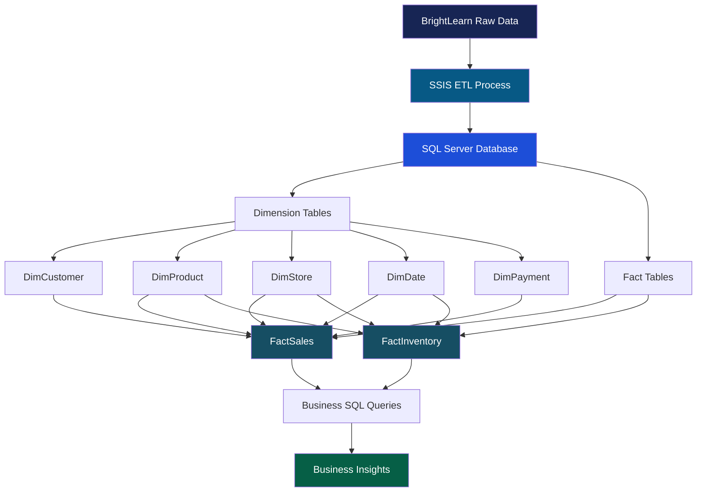

# brightlearn_de_exam_seluleko_manqele

# ⚡ BRIGHTLEARN

# DATA ENGINEERING & DATA WAREHOUSE PROJECT

### Turning Raw Data into Meaningful Business Intelligence

**DESIGN • EXTRACT • TRANSFORM • LOAD • ANALYSE**


**DEVELOPED BY SELULEKO MANQELE**

*Junior Data Engineer | SQL Server | SSIS | Data Warehousing*

</div>

---

## 📌 01. PROJECT OVERVIEW

The **BrightLearn Data Warehouse Project** focuses on designing and developing a data warehouse solution using sales and inventory data provided by BrightLearn.

The primary objective is to transform raw operational data into structured, organised, and reliable information that supports business reporting, analytical querying, and informed decision-making.

Using Microsoft SQL Server, SQL Server Management Studio (SSMS), Visual Studio, and SQL Server Integration Services (SSIS), this project demonstrates the practical application of data engineering principles throughout the data lifecycle.

The project covers:

- Data extraction and ingestion.
- Data profiling and quality assessment.
- Relational database development.
- Database design and relationships.
- ETL pipeline development using SSIS.
- Data cleansing and transformation.
- Data validation and integrity checks.
- SQL-based business analysis.

The solution is designed to help BrightLearn understand sales performance, customer purchasing behaviour, product performance, store revenue, and inventory levels.

---

## 🎯 02. PROJECT OBJECTIVES

| Objective | Description |
|---|---|
| Data Ingestion | Import and examine raw business data |
| Data Profiling | Identify missing values, duplicates and inconsistencies |
| Database Design | Develop a structured relational database |
| ETL Development | Build data integration workflows using SSIS |
| Data Transformation | Clean, standardise and convert source data |
| Data Validation | Verify data quality and database integrity |
| Business Analysis | Develop SQL queries to answer business questions |
| Documentation | Maintain technical documentation and project evidence |

---

## 🛠️ 03. TECHNOLOGY STACK

<div align="center">

| Technology | Application |
|---|---|
| Microsoft SQL Server | Database development and data storage |
| SSMS | Database management and SQL development |
| SSIS | ETL pipeline development |
| Visual Studio | SSIS package development |
| T-SQL | Data transformation and analytical querying |
| Git | Version control |
| GitHub | Source code and project documentation |

</div>

---

## 📂 04. DATASET DESCRIPTION

The project uses the provided `BrightLearn_Raw_Data.csv` dataset.

**Dataset period:** January – June 2024

The dataset contains the following business information:

| Data Category | Description |
|---|---|
| Transactions | Transaction dates, payment methods, amounts and discounts |
| Customers | Customer names, contact details, locations and loyalty tiers |
| Products | Product names, SKUs, categories, prices, costs and suppliers |
| Stores | Store names, locations, regions and store managers |
| Sales | Quantities sold and line amounts |
| Inventory | Stock on hand and reorder thresholds |

**Dataset Grain:** Each row represents an individual product line item within a sales transaction.

---

## 🏗️ 05. DATA WAREHOUSE DESIGN

The data warehouse design separates descriptive business information into dimension tables and measurable business activities into fact tables.

### Dimension Tables

| Table | Description |
|---|---|
| DimCustomer | Customer information and loyalty details |
| DimProduct | Product details, categories, prices and suppliers |
| DimStore | Store information, locations and management details |
| DimDate | Calendar dates, months, quarters and years |
| DimPayment | Payment methods and cashier information |

### Fact Tables

| Table | Description |
|---|---|
| FactSales | Sales quantities, line amounts, transaction amounts and discounts |
| FactInventory | Stock on hand and reorder thresholds |

### Database Architecture

The following diagram illustrates the intended data warehouse structure.



---

## ⚙️ 06. ETL PIPELINE DEVELOPMENT

The project follows the Extract, Transform, Load (ETL) methodology using SQL Server Integration Services (SSIS).

### ETL Workflow


### 1. Extract

- Connect to the BrightLearn CSV dataset.
- Import source records.
- Examine columns and data structures.

### 2. Transform

- Handle missing and NULL values.
- Identify duplicate records.
- Standardise inconsistent formats.
- Convert data types.
- Apply appropriate business rules.
- Validate transformed records.

### 3. Load

- Load processed information into SQL Server.
- Maintain database relationships.
- Validate destination records.
- Verify data consistency.

---

## 🧹 07. DATA QUALITY MANAGEMENT

Data quality is essential for building reliable data solutions.

The project considers the following validation dimensions:

| Quality Dimension | Validation |
|---|---|
| Completeness | Missing and NULL values |
| Uniqueness | Duplicate records |
| Validity | Invalid dates and numerical values |
| Consistency | Standardised formats |
| Integrity | Primary and foreign key relationships |
| Accuracy | Validation against defined business rules |

A Data Quality Findings Report documents identified issues, their impact, and the actions taken to address them.

---

## 📊 08. BUSINESS INTELLIGENCE & SQL ANALYSIS

The project includes eight business questions (BQ-01 to BQ-08) designed to demonstrate how SQL can transform structured business data into useful information.

The analytical areas include:

**Sales Analysis**
- Revenue performance.
- Sales trends.
- Store performance.
- Transaction analysis.

**Customer Analysis**
- Customer purchasing behaviour.
- Loyalty tier performance.
- Customer contribution to revenue.

**Product Analysis**
- Product performance.
- Product categories.
- Sales and cost analysis.

**Inventory Analysis**
- Stock availability.
- Reorder thresholds.
- Inventory management.

The SQL solutions and their results are documented as part of the project deliverables.

---

## 💡 09. BUSINESS VALUE

This project demonstrates how data engineering contributes to business operations.

| Business Area | Potential Value |
|---|---|
| Sales | Better visibility into sales performance |
| Customers | Improved understanding of purchasing behaviour |
| Products | Better product performance analysis |
| Stores | Comparison of store revenue and performance |
| Inventory | Improved stock monitoring |
| Data Quality | More reliable business information |

**The goal is to establish a structured data foundation that supports reliable business reporting and decision-making.**

---

## 📁 10. PROJECT REPOSITORY STRUCTURE

```text
brightlearn_de_exam_seluleko_manqele/
│
├── README.md
│
├── Dataset/
│   └── BrightLearn_Raw_Data.csv
│
├── SQL/
│   ├── Database_Creation.sql
│   ├── Table_Creation.sql
│   ├── Data_Quality_Checks.sql
│   ├── Data_Cleansing.sql
│   ├── Data_Transformation.sql
│   └── Business_Queries.sql
│
├── SSIS/
│   └── SSIS_Project/
│
├── Documentation/
│   ├── Database_Design/
│   ├── ERD/
│   ├── Data_Quality_Report/
│   └── ETL_Documentation/
│
└── Screenshots/
    ├── Database/
    ├── SSIS/
    └── SQL_Results/
```

---

## 🚀 11. PROJECT DELIVERABLES

- [ ] Source data ingestion.
- [ ] Database creation and development.
- [ ] Entity Relationship Diagram (ERD).
- [ ] Data quality assessment.
- [ ] Data cleansing and transformation.
- [ ] SSIS ETL package development.
- [ ] Data validation and testing.
- [ ] Eight business SQL queries.
- [ ] Technical documentation.
- [ ] Project demonstration.

---

## 📚 12. TECHNICAL SKILLS DEMONSTRATED

| Technical Area | Skills |
|---|---|
| Database Engineering | SQL Server, relational database design |
| SQL Development | T-SQL, querying and data manipulation |
| Data Integration | SSIS, ETL development |
| Data Quality | Cleansing, validation and deduplication |
| Data Modelling | Database relationships and dimensional modelling |
| Development Tools | SSMS, Visual Studio |
| Version Control | Git and GitHub |
| Business Analysis | Translating business requirements into SQL queries |

---

## 👩‍💻 13. ABOUT THE DEVELOPER

<div align="center">

### SELULEKO MANQELE

**Aspiring Data Engineer**

SQL Server | SSIS | Data Integration | Data Warehousing

</div>

I am building my career in data engineering, with a strong interest in database development, ETL pipeline engineering, data integration, and data quality.

My learning approach focuses on practical implementation, solving business problems, developing technical solutions, and understanding how data moves from source systems into structured environments.

The BrightLearn Data Warehouse Project represents my practical application of data engineering concepts and my commitment to developing industry-relevant technical skills.

### Career Interests

- Data Engineering
- ETL Pipeline Development
- SQL Server Development
- Data Integration
- Data Quality Engineering
- Database Development
- Business Data Analysis

---

<div align="center">

# ⚡ BUILDING DATA SOLUTIONS THAT CREATE VALUE

**DESIGN • INTEGRATE • TRANSFORM • VALIDATE**

Developed by **Seluleko Manqele**

*Turning data into opportunities.*


</div>
:::
**Dataset Grain:** Each row represents an individual product line item within a sales transaction.

## 5. Data Warehouse Design

The data warehouse follows a dimensional modelling approach, separating descriptive information into dimension tables and measurable business activities into fact tables.

### 5.1 Dimension Tables

| Table | Description |
|---|---|
| DimCustomer | Stores customer information and loyalty details |
| DimProduct | Stores product details, categories, prices, and supplier information |
| DimStore | Stores store information, including locations and management details |
| DimDate | Stores calendar information, including dates, months, quarters, and years |
| DimPayment | Stores payment methods and cashier information |

### 5.2 Fact Tables

| Table | Description |
|---|---|
| FactSales | Stores sales measures, including quantities, line amounts, transaction amounts, and discounts |
| FactInventory | Stores inventory information, including stock on hand and reorder thresholds |

### 5.3 Database Relationships

The fact tables connect to their relevant dimension tables through foreign key relationships.

The planned relationships are:

**FactSales**
- DimCustomer
- DimProduct
- DimStore
- DimDate
- DimPayment

**FactInventory**
- DimProduct
- DimStore
- DimDate

These relationships support efficient querying and business analysis across different dimensions.

## 6. ETL Development Process

The project follows the Extract, Transform, Load (ETL) methodology.

### 6.1 Extract

- Import the raw CSV dataset.
- Examine the source data and column structures.
- Identify relevant business attributes.
- Prepare source data for transformation.

### 6.2 Transform

- Identify missing and NULL values.
- Check for duplicate records.
- Standardise inconsistent data formats.
- Validate date and numerical fields.
- Apply appropriate data transformations.
- Prepare data for dimensional loading.

### 6.3 Load

- Load customer, product, store, date, and payment dimensions.
- Load sales records into FactSales.
- Load inventory records into FactInventory.
- Validate loaded records and relationships.

SSIS is used to develop and manage the ETL workflows.

## 7. Data Quality and Validation

Data quality is essential to building a reliable data warehouse.

The project considers the following validation checks:

- Missing and NULL values.
- Duplicate records.
- Invalid dates.
- Inconsistent text formats.
- Incorrect numerical values.
- Referential integrity.
- Data type compatibility.
- Source-to-target record validation.

## 8. Business Questions

The data warehouse is designed to answer important business questions.

**Sales Analysis**
- What is the total sales revenue?
- Which months generate the highest revenue?
- Which stores generate the most sales?
- What are the overall sales trends?

**Customer Analysis**
- Which customers contribute the most revenue?
- Which loyalty tiers generate the highest sales?
- What are the customer purchasing patterns?

**Product Analysis**
- Which products sell the most?
- Which product categories generate the highest revenue?
- Which products contribute the most to profitability?

**Inventory Analysis**
- Which products are below their reorder thresholds?
- Which stores have low stock levels?
- Which products require restocking?

## 9. Expected Project Deliverables

- SQL Server database.
- Dimension and fact tables.
- Database relationships.
- Data quality and validation scripts.
- SSIS ETL packages.
- Data transformation scripts.
- Analytical SQL queries.
- Project documentation and screenshots.

## 10. Repository Structure

```text
brightlearn_de_exam_seluleko_manqale/
│
├── README.md
│
├── dataset/
│   └── BrightLearn_Raw_Data.csv
│
├── SQL/
│   ├── Database_Creation.sql
│   ├── Table_Creation.sql
│   ├── Data_Quality_Checks.sql
│   ├── Data_Transformation.sql
│   ├── Dimension_Loading.sql
│   ├── Fact_Loading.sql
│   └── Business_Queries.sql
│
├── SSIS/
│   └── SSIS_Project/
│
├── Documentation/
│   ├── Data_Dictionary.md
│   ├── Data_Warehouse_Design.md
│   └── ETL_Documentation.md
│
└── Screenshots/
    ├── Database_Design/
    ├── SSIS_Packages/
    └── Query_Results/
```

## 11. Skills Demonstrated

- SQL Server database development.
- T-SQL programming.
- Relational database design.
- Dimensional modelling.
- Data cleaning and validation.
- ETL pipeline development.
- SSIS package development.
- Data warehousing concepts.
- Analytical SQL querying.
- GitHub documentation and version control.

## 12. Project Status

**Status: In Development**

This repository documents my practical experience in developing a data warehouse using SQL Server and SSIS.

Project documentation and deliverables will be updated as development progresses.

---

<div align="center">

### DEVELOPED BY SELULEKO MANQELE

**Junior Data Engineer**

*Building reliable data pipelines. Transforming data into insights.*

</div>
